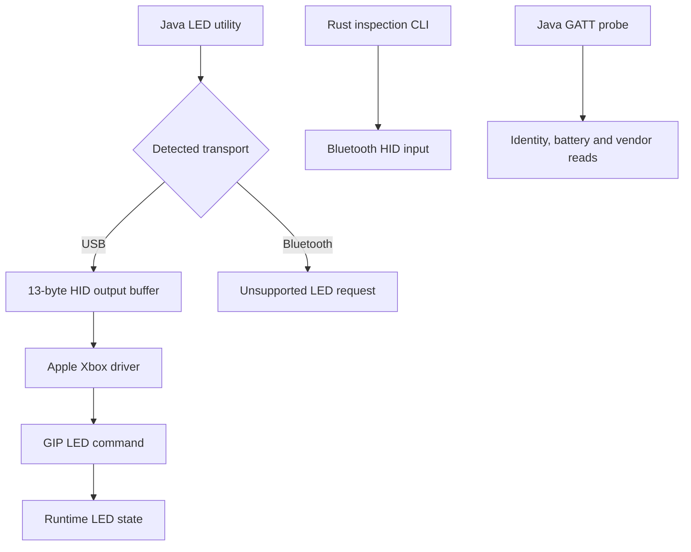

# Analysis reference

[README](../README.md) | [USB](usb.md) | [Bluetooth](bluetooth-macos.md) | [Firmware](firmware.md)

Evidence recorded through 2026-10-15. Target: Xbox Series X|S on macOS,
USB `045e:0b12`, Bluetooth LE `045e:0b13`.

## Results

| Area                  | Verified result                                                   | Boundary                                                  |
| --------------------- | ----------------------------------------------------------------- | --------------------------------------------------------- |
| USB LED               | Off, steady brightness and host-generated glow work               | Brightness is lost after unplugging                       |
| Shared USB HID        | 13-byte output buffer accepted; system driver remains attached    | Seven-byte writes abort                                   |
| Bluetooth HID         | Rumble accepted; 24 original LED variants and 4 later writes fail | macOS rejects writes before confirmed controller delivery |
| Bluetooth vendor GATT | Four seven-byte LED packets acknowledged                          | No visible LED change                                     |
| Hidden HID service    | Present in fresh-pairing ATT capture                              | CoreBluetooth discovery and direct reads denied           |
| Firmware analysis     | MERL `5.23.6.0` LED dispatch and PWM path recovered               | Installed `5.9.2709.0` image unavailable                  |
| Firmware readback     | USB descriptors obtained                                          | No flash dump or verified readback command                |

> [!IMPORTANT]
> The analysed updater image differs from the installed firmware. Failed Bluetooth
> tests establish limits of the tested interfaces and states; they do not establish
> that every possible Bluetooth LED command is absent. No firmware was updated.

## Transport paths



## Documentation and evidence

| Reference                       | Embedded results                                                         |
| ------------------------------- | ------------------------------------------------------------------------ |
| [USB](usb.md)                   | Buffers, driver addresses, transfer counters and readback errors         |
| [Bluetooth](bluetooth-macos.md) | Service/characteristic tables, capture counts, descriptor hash and tests |
| [Firmware](firmware.md)         | Package hashes, startup regions, GIP/GATT dispatch tables and emulation  |

Results are embedded beside their interpretation. Local artifact names identify
provenance or regeneration paths. Captures, downloaded binaries and generated
analysis remain ignored.

## Repository layout

```text
README.md                 Installation and command reference
docs/                     Technical references and embedded results
src/                      Rust Bluetooth inspection CLI
examples/                 Bounded Bluetooth HID experiment
tools/                    Java device and firmware utilities
  analysis/               ATT, descriptor, PDF and documentation helpers
  ghidra/                 Firmware analysis and emulation scripts
target/                   Ignored local data and build output
  debug/, release/        Cargo output
  cargo-home/, jbang/     Dependency caches
  firmware/               Pinned firmware downloader output
  firmware-analysis/      Ghidra project, exports and verification output
  research/
    apps/                 PacketLogger and extracted Apple tools
    archive/              Earlier working copies and history backups
    bluetooth/            HCI captures, decoded ATT, GATT and descriptor logs
    firmware/             Version searches, archives and download logs
    helpers/              Untracked experimental Java sources
    references/           Downloaded sources and driver investigations
    usb/                  USB descriptors, registry and probe logs
    manifest.tsv          Original/new paths, sizes and SHA-256 of moved files
```

Firmware utility defaults stay at `target/firmware/` and
`target/firmware-analysis/`. Commands run from the repository root.
Capture moves preserve contents and permissions; private captures use `0600`.

## Documentation checks

```sh
mise exec java@corretto-25 -- jbang tools/analysis/CheckXboxAnalysis.java

# Reformat Markdown tables before checking.
mise exec java@corretto-25 -- jbang tools/analysis/CheckXboxAnalysis.java --format
```

Checks cover local links, heading anchors, reference definitions, table alignment,
code fences and collapsible sections. They require no controller, downloaded
firmware or captures. Hardware and firmware results retain their recorded dates.

## Open questions

- [ ] Find a verified Bluetooth brightness or LED readback command for this model.
- [ ] Obtain and identify the installed `5.9.2709.0` application image.
- [ ] Establish vendor command `0x28` semantics on installed firmware.
- [ ] Verify a firmware readback protocol before attempting flash extraction.
