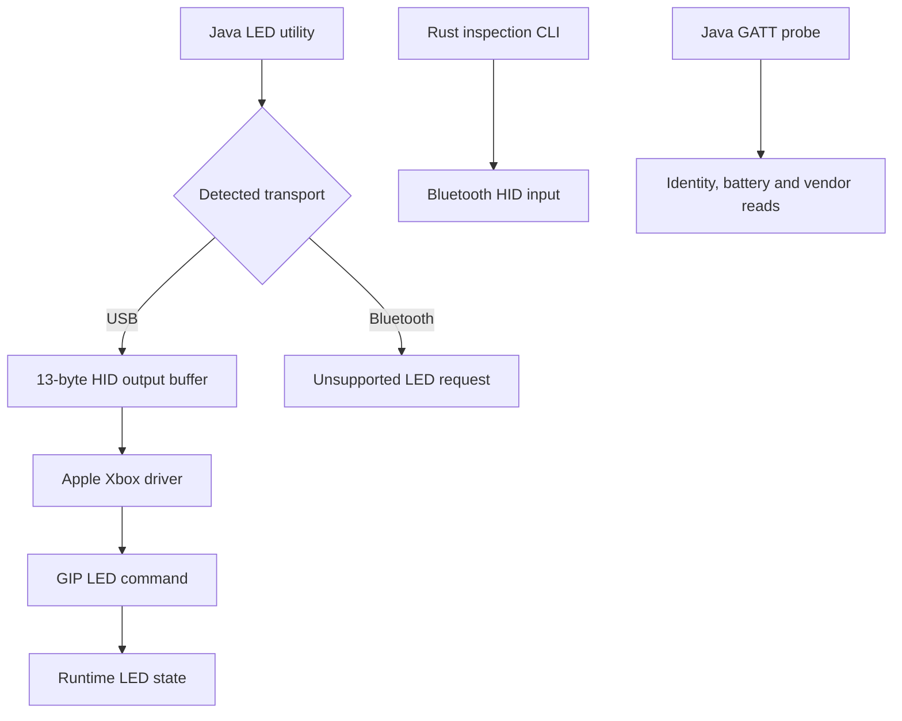

# Controller research findings

[README](../README.md) | [USB](usb.md) | [Bluetooth](bluetooth-macos.md) | [Firmware](firmware.md)

Evidence recorded through 2026-10-24. Target: Xbox Series X|S on macOS,
USB `045e:0b12`, Bluetooth LE `045e:0b13`.

USB brightness control works. No repeatable Bluetooth brightness change has
been observed through macOS or the XIAO. The initial tests used `5.9.2709.0`.
After updating, fresh XIAO discovery confirmed `5.23.6.0`, matching the analysed
release. Seven direct BLE LED formats and HID Suspend/Resume left the light
unchanged; both USB LED paths worked. The built-in macOS Bluetooth path was
not retested. Exact requests, observations and run locations are in the
[post-update campaign](brightness-campaign.md#post-update-results-52360).

Firmware analysis identifies an EEPROM-backed startup cap. Its candidate byte
remained 80 after the update. An unchanged-record write on `5.9.2709.0` received
no matching completion; subsequent reads verified the original intact. Cap 5
and restoration were not tested. No EEPROM write was repeated on `5.23.6.0`.

## Firmware versions

Checked on 2026-10-24 for the MERL controller family. Both installed versions
were read through GATT. The [USB component readback](firmware-update.md#recorded-update-result)
also confirms the post-update versions and partition metadata.

| Source                    | Version       | Evidence                                                           |
| ------------------------- | ------------- | ------------------------------------------------------------------ |
| Microsoft Xbox console GA | `5.23.6.0`    | Current `xbox_ga` feed, index version `1.0.0.20`, MERL package     |
| Microsoft PC GA           | `5.23.6.0`    | Current `pc_ga` feed, index version `1.0.0.23`, same MERL package  |
| Controller before update  | `5.9.2709.0`  | GATT Firmware Revision `2A26`, captured in the XIAO run            |
| Controller after update   | `5.23.6.0`    | Fresh XIAO GATT read and user-provided USB component-3 readback    |
| Analysed application      | `5.23.6.0`    | Component 3 extracted from the pinned Microsoft updater            |

The [Xbox feed](https://aka.ms/xboxaccessoriesfwcdnxbga) and
[PC feed](https://aka.ms/xboxaccessoriesfwcdnpcga) offer the same MERL package.
Both list `5.9.2709.0` as a prerequisite, separately from the offered version.
The exact earlier image remains unavailable. Package hashes and image provenance
are in the [firmware reference](firmware.md#download-and-package-identity).

## Results

| Area                  | Verified result                                                                                                | Boundary                                                             |
| --------------------- | -------------------------------------------------------------------------------------------------------------- | -------------------------------------------------------------------- |
| USB LED               | Off, steady brightness and host-generated glow work                                                            | Brightness is lost after unplugging                                  |
| Shared USB HID        | 13-byte output buffer accepted; system driver remains attached                                                 | Seven-byte writes abort                                              |
| Bluetooth HID         | Rumble accepted; 24 original LED variants and 4 later writes fail                                              | macOS rejects writes before confirmed controller delivery            |
| Bluetooth vendor GATT | Four seven-byte LED packets acknowledged                                                                       | No visible LED change                                                |
| Hidden HID service    | Present in fresh-pairing ATT capture                                                                           | CoreBluetooth discovery and direct reads denied                      |
| XIAO direct BLE       | Seven LED formats tested; accepted padded HID and vendor writes left the light unchanged                       | Retested on `5.23.6.0`; Suspend/Resume also left the light unchanged |
| Firmware analysis     | MERL `5.23.6.0` LED dispatch and PWM path recovered                                                            | Pre-update `5.9.2709.0` image unavailable                            |
| Indirect brightness   | Record-0 cap candidate is 80; unchanged-record write returned no matching completion; original verified intact | No cap change, successful write, verified restore or BLE ingress     |
| Windows drivers       | LED API traced through IOCTL `0x40001c60` to GIP `0x0a`; XInput HID LED state is cached                        | Static Windows 11 analysis; no new Bluetooth brightness command      |
| Firmware readback     | USB read command `0x1601` attempted after unlock; no matching reply                                            | No application flash dump or verified flash-read command             |

> [!IMPORTANT]
> Direct XIAO tests now use the analysed application release. The macOS Bluetooth
> results remain from `5.9.2709.0`. No installed flash dump was obtained.
> Negative observations establish limits of the tested interfaces and states.

## Indirect brightness controls

At startup, the analysed application reads 26 bytes from logical record 0 and
loads payload byte 22 into the LED driver. The driver applies
`min(requested, cap)`; its compiled fallback is 80, in internal driver units.
Offline execution verifies the clamp and a configuration-copy path.

USB reads on both tested versions returned the same valid record, with byte 22
equal to 80. The failed pre-update write establishes no working write/restore
operation. Record 0 also contains controller identity data. Its optical effect
and a BLE-accessible configuration command remain unverified.

The [firmware reference](firmware.md#indirect-brightness-controls) contains the
addresses, record layout, write candidate, excluded alternatives and reproduction
commands. Pairing, connection and identification patterns are excluded from
this investigation's brightness avenues.

## Windows drivers

The [driver audit](windows-drivers.md) traces the public intensity API to the
known GIP LED command. XInput HID caches its LED byte without sending output;
the inspected HID-over-GATT path forwards HID reports without a recovered LED
translation. The synthetic GIP queue's external consumer, Xbox Accessories and
GameInput services remain coverage gaps. No new BLE command was established.

## Firmware updates

[xboxctl](https://github.com/bb441db/xboxctl) was used to inspect component
versions and update the controller over USB. The [update reference](firmware-update.md)
records commands, package identity and final versions. The update produced no
observed Bluetooth brightness benefit in the subsequent XIAO tests.

## Transport paths



## Documentation and evidence

| Reference                                     | Embedded results                                                         |
| --------------------------------------------- | ------------------------------------------------------------------------ |
| [USB](usb.md)                                 | Buffers, driver addresses, transfer counters and readback errors         |
| [Bluetooth](bluetooth-macos.md)               | Service/characteristic tables, capture counts, descriptor hash and tests |
| [XIAO](bluetooth-xiao.md)                     | Direct BLE writes, native prompts, ATT status and user observations      |
| [Windows drivers](windows-drivers.md)         | API, IOCTL, GIP sender, HID cache and binary provenance                  |
| [Firmware](firmware.md)                       | Package hashes, startup regions, GIP/GATT dispatch tables and emulation  |
| [Brightness campaign](brightness-campaign.md) | Physical observations, exact requests and run provenance                 |
| [Firmware updates](firmware-update.md)        | Component versions, official methods, downloads and USB update commands  |

Results are embedded beside their interpretation. Local artifact names identify
provenance or regeneration paths. Captures, downloaded binaries and generated
analysis remain ignored.

## Repository layout

```text
README.md                 Installation and command reference
docs/                     Technical references and embedded results
src/                      Rust Bluetooth inspection CLI
examples/                 Bounded Bluetooth HID experiment
tools/                    Java device and firmware utilities
  analysis/               ATT, descriptor, PDF and documentation helpers
  ghidra/                 Firmware analysis and emulation scripts
target/                   Ignored local data and build output
  cargo-home/, jbang/      Dependency caches
  firmware/               Pinned firmware downloader output
  firmware-analysis/      Ghidra project, exports and verification output
  windows-analysis/       Windows driver project, symbols and selected function exports
  xboxctl/, xboxctl-build/ Pinned third-party checkout and build output
  campaigns/, xiao/       Private physical-test transcripts and snapshots
  research/               Captures, downloaded references and earlier artifacts
```

Firmware utility defaults stay at `target/firmware/` and
`target/firmware-analysis/`. Commands run from the repository root.
Capture moves preserve contents and permissions; private captures use `0600`.

## Documentation checks

```sh
mise exec java@corretto-25 -- jbang tools/analysis/CheckXboxAnalysis.java

# Reformat Markdown tables before checking.
mise exec java@corretto-25 -- jbang tools/analysis/CheckXboxAnalysis.java --format
```

Checks cover local links, heading anchors, reference definitions, table alignment,
code fences and collapsible sections. They require no controller, downloaded
firmware or captures. Hardware and firmware results retain their recorded dates.

## Open questions

- [ ] Find a verified Bluetooth brightness or LED readback command for this model.
- [ ] Find a BLE ingress to a steady-brightness control or configuration command.
- [ ] Establish a working record write and verified restoration; the unchanged-record baseline received no matching completion.
- [ ] Establish vendor command `0x28` semantics on installed firmware.
- [ ] Verify a firmware readback protocol before attempting flash extraction.
- [ ] Investigate component transitions and macOS USB recapture; an official update trace would supply additional evidence.
