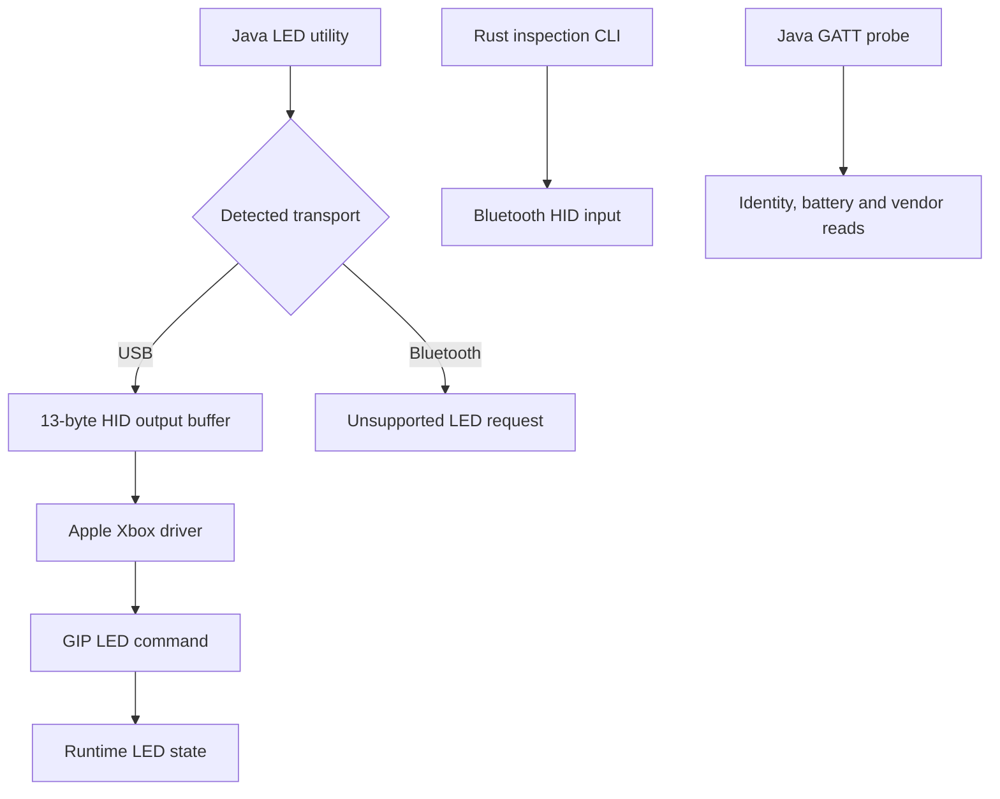

# Analysis reference

[README](../README.md) | [USB](usb.md) | [Bluetooth](bluetooth-macos.md) | [Firmware](firmware.md)

Evidence recorded through 2026-10-24. Target: Xbox Series X|S on macOS,
USB `045e:0b12`, Bluetooth LE `045e:0b13`.

## Firmware versions

Checked on 2026-10-24 for the MERL controller family (`045e:0b12` over USB,
`045e:0b13` over Bluetooth). These versions do not describe every Xbox controller
model or an Insider release channel.

| Source                    | Version       | Evidence                                                           |
| ------------------------- | ------------- | ------------------------------------------------------------------ |
| Microsoft Xbox console GA | `5.23.6.0`    | Current `xbox_ga` feed, index version `1.0.0.20`, MERL package     |
| Microsoft PC GA           | `5.23.6.0`    | Current `pc_ga` feed, index version `1.0.0.23`, same MERL package  |
| Connected controller      | `5.9.2709.0`  | GATT Firmware Revision `2A26`, read during the 2026-10-24 XIAO run |
| Analysed application      | `5.23.6.0`    | Component 3 extracted from the pinned Microsoft updater            |

The [Xbox feed](https://aka.ms/xboxaccessoriesfwcdnxbga) and
[PC feed](https://aka.ms/xboxaccessoriesfwcdnpcga) were downloaded again for this
check. Both advertise the same MERL package and list `5.9.2709.0` as a minimum
required version, separately from the offered package version. Neither feed
provides the installed `5.9.2709.0` application image. No controller firmware
was updated. Package hashes, component versions and image provenance are in
the [firmware reference](firmware.md#download-and-package-identity).

The installed-version read is in local run
`target/xiao/runs/2026-10-24T15-01-43.722083Z.log`, recorded as
`FIRMWARE 5.9.2709.0`.

## Results

| Area                  | Verified result                                                                                                | Boundary                                                            |
| --------------------- | -------------------------------------------------------------------------------------------------------------- | ------------------------------------------------------------------- |
| USB LED               | Off, steady brightness and host-generated glow work                                                            | Brightness is lost after unplugging                                 |
| Shared USB HID        | 13-byte output buffer accepted; system driver remains attached                                                 | Seven-byte writes abort                                             |
| Bluetooth HID         | Rumble accepted; 24 original LED variants and 4 later writes fail                                              | macOS rejects writes before confirmed controller delivery           |
| Bluetooth vendor GATT | Four seven-byte LED packets acknowledged                                                                       | No visible LED change                                               |
| Hidden HID service    | Present in fresh-pairing ATT capture                                                                           | CoreBluetooth discovery and direct reads denied                     |
| XIAO direct BLE       | Padded HID and vendor LED writes acknowledged; user observed no change                                         | Bypasses macOS; Suspend/Resume also left brightness unchanged       |
| Firmware analysis     | MERL `5.23.6.0` LED dispatch and PWM path recovered                                                            | Installed `5.9.2709.0` image unavailable                            |
| Indirect brightness   | Record-0 cap candidate is 80; unchanged-record write returned no matching completion; original verified intact | No cap change, successful write, verified restore or BLE ingress    |
| Windows drivers       | LED API traced through IOCTL `0x40001c60` to GIP `0x0a`; XInput HID LED state is cached                        | Static Windows 11 analysis; no new Bluetooth brightness command     |
| Firmware readback     | USB read command `0x1601` attempted after unlock; no matching reply                                            | No application flash dump or verified flash-read command            |

> [!IMPORTANT]
> The analysed updater image differs from the installed firmware. Failed Bluetooth
> tests establish limits of the tested interfaces and states; they do not establish
> that every possible Bluetooth LED command is absent. No controller firmware was updated.

## Indirect brightness controls

The strongest new lead is the EEPROM-backed brightness cap. The analysed
application reads 26 bytes from logical record 0, loads byte 22 into the LED
driver at startup, and applies `min(requested, cap)` to later requests. The
compiled fallback cap is 80, in internal driver units. It is separate from the
runtime brightness that USB already controls.

Offline execution verifies caps 0, 5, 20 and 80, and an internal configuration
copy that can reach the cap byte. The USB/GIP factory dispatcher maps to that
application command and accepts the required length at permission level 1.
The reconstructed startup level is 2; its unlock sequence was verified offline.
No BLE ingress to this dispatcher was recovered. USB reads of the installed
record now match twice and pass framing and checksum validation; byte 22 is 80.
The user subsequently authorised a guarded write/restore test. Its first step
attempted to write the original record unchanged through the Windows driver's
`0x0306` command. No matching completion arrived. Two subsequent reads verified
the original full slot intact, so the runner stopped before cap 5. The user
confirmed a power cycle. A successful write and restore remain unverified.
Record 0 also contains device identity data.

The [firmware reference](firmware.md#indirect-brightness-controls) contains the
addresses, record layout, write candidate, excluded alternatives and reproduction
commands. Pairing, connection and identification patterns are excluded from
this investigation's brightness avenues.

## Windows drivers

The [Windows driver reference](windows-drivers.md) traces Microsoft's public
LED API, its driver IOCTL and the Bluetooth HID comparison using downloaded
binaries and matching public symbols. The GIP worker sends the known LED
command. The Bluetooth XInput LED flag updates host memory without HID output.
The USB driver `dc1-controller.sys` resolves the test-command route to vendor
USB requests. Xbox Wireless wraps those requests in GIP `0x1f`. Synthetic GIP
completes Windows read requests; its external consumer remains unresolved. A nine-entry
firmware L2CAP registry also supplies no distinct LE GIP service: eight entries
use constant-return stubs, and the remaining entry is ATT.

The XIAO-first checkpoint is local commit `9edcc08` (`feat: add guided XIAO
Bluetooth experiments`). It contains the runner, responsive native dialogs,
sketch, Arduino configuration and documentation, including Homebrew installation
and technical serial commands. Firmware and Windows analysis remains uncommitted.
None of the newly traced runtime routes supplies a verified BLE payload.
The macOS Bluetooth port remains conditional on repeatable XIAO success.

The [guided brightness campaign](brightness-campaign.md) now tests bounded
factory-format hypotheses through the XIAO, followed by the recovered USB
runtime route and read-only record-0 inspection. It uses untimed native dialogs,
explicit observations and a command whitelist that excludes persistent writes.
All four BLE trials were acknowledged without a reported light change. USB
factory unlock and steady LED commands worked, and the record-0 snapshot was
saved privately. The user confirmed the final power cycle. Exact requests and
run provenance are in the campaign reference.

The separate stored-cap runner requires explicit EEPROM-write authorisation,
saves the original privately, verifies an unchanged-record baseline before any
cap change, and restores the saved record after a trial. Its completed baseline
test found no working write route. A read-only application dump also stopped
when `0x1601` returned no matching reply. Both failures are consistent with the
newer firmware's level-1 whitelist, without establishing the older firmware's
exact permission gate. The installed image remains unavailable.

A [follow-up Windows audit](windows-drivers.md#follow-up-audit-newer-xinput-and-the-lower-ble-driver)
checks XInput HID `10.0.28000.3086` and HID-over-GATT `10.0.26100.9278`.
The newer extended state handler still caches its LED byte, and the inspected
HOGP write path maps HID Report References to GATT writes. The synthetic GIP
queue's external consumer and companion services remain coverage gaps. These
results do not establish that all Windows Bluetooth brightness paths are absent.

## Transport paths



## Documentation and evidence

| Reference                             | Embedded results                                                         |
| ------------------------------------- | ------------------------------------------------------------------------ |
| [USB](usb.md)                         | Buffers, driver addresses, transfer counters and readback errors         |
| [Bluetooth](bluetooth-macos.md)       | Service/characteristic tables, capture counts, descriptor hash and tests |
| [XIAO](bluetooth-xiao.md)             | Direct BLE writes, native prompts, ATT status and user observations      |
| [Windows drivers](windows-drivers.md) | API, IOCTL, GIP sender, HID cache and binary provenance                  |
| [Firmware](firmware.md)               | Package hashes, startup regions, GIP/GATT dispatch tables and emulation  |

Results are embedded beside their interpretation. Local artifact names identify
provenance or regeneration paths. Captures, downloaded binaries and generated
analysis remain ignored.

## Repository layout

```text
README.md                 Installation and command reference
docs/                     Technical references and embedded results
src/                      Rust Bluetooth inspection CLI
examples/                 Bounded Bluetooth HID experiment
tools/                    Java device and firmware utilities
  analysis/               ATT, descriptor, PDF and documentation helpers
  ghidra/                 Firmware analysis and emulation scripts
target/                   Ignored local data and build output
  debug/, release/        Cargo output
  cargo-home/, jbang/     Dependency caches
  firmware/               Pinned firmware downloader output
  firmware-analysis/      Ghidra project, exports and verification output
  windows-analysis/       Windows driver project, symbols and selected function exports
  research/
    apps/                 PacketLogger and extracted Apple tools
    archive/              Earlier working copies and history backups
    bluetooth/            HCI captures, decoded ATT, GATT and descriptor logs
    firmware/             Version searches, archives and download logs
    helpers/              Untracked experimental Java sources
    references/           Downloaded sources and driver investigations
    usb/                  USB descriptors, registry and probe logs
    manifest.tsv          Original/new paths, sizes and SHA-256 of moved files
```

Firmware utility defaults stay at `target/firmware/` and
`target/firmware-analysis/`. Commands run from the repository root.
Capture moves preserve contents and permissions; private captures use `0600`.

## Documentation checks

```sh
mise exec java@corretto-25 -- jbang tools/analysis/CheckXboxAnalysis.java

# Reformat Markdown tables before checking.
mise exec java@corretto-25 -- jbang tools/analysis/CheckXboxAnalysis.java --format
```

Checks cover local links, heading anchors, reference definitions, table alignment,
code fences and collapsible sections. They require no controller, downloaded
firmware or captures. Hardware and firmware results retain their recorded dates.

## Open questions

- [ ] Find a verified Bluetooth brightness or LED readback command for this model.
- [x] Trace USB/GIP factory ingress, permissions and payload length to the record-0 configuration command offline.
- [ ] Find a BLE ingress to a steady-brightness control or configuration command.
- [x] Read the installed record-0 slot twice and validate its framing and checksum.
- [ ] Establish a working record write and verified restoration; the unchanged-record baseline received no matching completion.
- [ ] Obtain and identify the installed `5.9.2709.0` application image.
- [ ] Establish vendor command `0x28` semantics on installed firmware.
- [ ] Verify a firmware readback protocol before attempting flash extraction.
