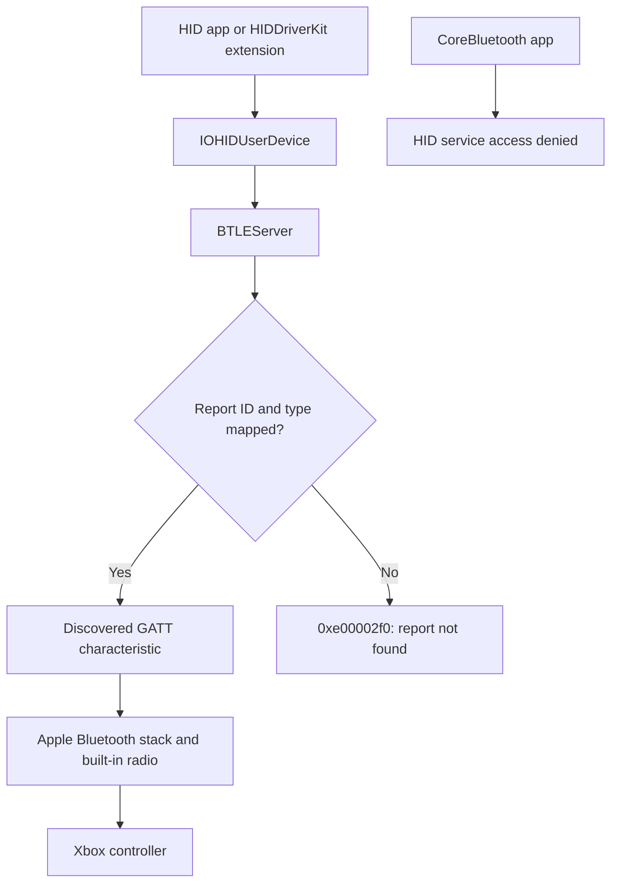

# Bluetooth on macOS

[Analysis](analysis.md) | [USB](usb.md) | [Firmware](firmware.md)

Evidence: 2026-10-04 through 2026-10-15. Target: Series X|S `045e:0b13`,
firmware `5.9.2709.0`, built-in Mac radio, SIP enabled.

## Support and results

| Interface or test          | Result                                                               | Boundary                                                  |
| -------------------------- | -------------------------------------------------------------------- | --------------------------------------------------------- |
| Bluetooth LED control      | No verified brightness, glow or readback                             | Java utility reports unsupported                          |
| Standard HID descriptor    | 283 bytes; input `01`, rumble output `03`; no feature or LED reports | Matches raw controller Report Map                         |
| HID LED sweep              | 24/24 candidates rejected, `0xe00002f0`                              | No confirmed delivery to controller                       |
| USB-framed Bluetooth retry | 4/4 LED writes rejected                                              | Seven- and thirteen-byte packets, report IDs `0a` and `1` |
| Zero-strength rumble       | Nine-byte output accepted                                            | Confirms output access for the declared rumble report     |
| CoreBluetooth discovery    | Device Information, Battery and vendor services exposed              | HID `1812` omitted                                        |
| Fresh-pairing capture      | Six primary services, HID characteristics and Report Map             | Discovery below CoreBluetooth                             |
| Raw ATT vs CoreBluetooth   | Seven readable values match byte for byte                            | No discrepancy in exposed data                            |
| Private hidden HID access  | Discovery and direct Report Map read denied                          | Synthetic objects do not bypass service restrictions      |
| Vendor GATT LED writes     | 4/4 acknowledged; no visible LED change                              | Tested GIP payloads and connected state only              |

> [!IMPORTANT]
> These tests establish the limits of the tested interfaces. They do not prove
> that every possible Bluetooth LED command is absent. The analysed firmware
> `5.23.6.0` differs from installed `5.9.2709.0`.

## macOS report path



| Component                                                            | Recorded observation                                                                       | Consequence                                            |
| -------------------------------------------------------------------- | ------------------------------------------------------------------------------------------ | ------------------------------------------------------ |
| Xbox HID provider                                                    | `BTLEServer`, PID 739, creates `IOHIDUserDevice`                                           | Upper HID replacement retains report mapping           |
| HID event handler                                                    | `IOHIDEventDummyService`, `AppleGameControllerPersonality`                                 | Separate from radio transport                          |
| Radio                                                                | `AppleBluetoothModule`, `AppleConvergedIPCOLYBTControl`                                    | HID extension does not replace this layer              |
| `HIDService.writeReportData:reportID:reportType:withResponse:error:` | `0x10001fb04`, arm64e; lookup of discovered report characteristic                          | Missing mapping returns the observed `0xe00002f0`      |
| Direct CoreBluetooth read                                            | `0x199b9ded4`; message `0xcb` carries declaration/value handles                            | Changing the synthetic UUID does not alter the request |
| `CBManager.sendRawCommand:data:completionHandler:`                   | `0x199bd35c0`: `mov w0, #0; ret`                                                           | Stub in the inspected macOS build                      |
| IOBluetooth raw exports                                              | `BluetoothHCISendRawACLData`, `BluetoothHCISendRawCommand`, `sendRawHCIRequest`: same stub | Not called; no raw transport established               |

Apple's [IOHIDInterface](https://github.com/apple-oss-distributions/IOHIDFamily/blob/main/IOHIDFamily/IOHIDInterface.cpp)
and [IOHIDUserDevice](https://github.com/apple-oss-distributions/IOHIDFamily/blob/main/IOHIDFamily/IOHIDUserDevice.cpp)
sources show forwarding to the owning device and user-space provider. The local
`BTLEServer` disassembly supplies the characteristic-lookup result above.

## Hidden HID and vendor writes

### Hidden HID probe

[tools/XboxGattProbe.java](../tools/XboxGattProbe.java), mode `hidden-hid`,
uses private `CBService.initWithPeripheral:dictionary:` and
`CBPeripheral.setAttribute:forHandle:` constructors.

1. Verify matching PnP identity and firmware `5.9.2709.0`.
2. Construct service range `0016`-`0023` and request characteristics.
3. If discovery is rejected, construct Report Map `2A4B`, declaration `001b`,
   value `001c`, and read directly.

| Check                       | Result                                                  |
| --------------------------- | ------------------------------------------------------- |
| Constructor self-check      | UUIDs, properties and handles verified                  |
| Connected service discovery | `The specified UUID is not allowed for this operation.` |
| Direct Report Map read      | Same error; zero bytes                                  |
| Sandbox state               | Authorisation 2, state 2                                |
| Unsandboxed state           | Authorisation 3, state 5                                |
| Powered-off controller      | No discovery during 600-, 120- or 60-second waits       |

```sh
JBANG_DIR="$PWD/target/jbang" mise exec java@corretto-25 -- jbang tools/XboxGattProbe.java --self-test
JBANG_DIR="$PWD/target/jbang" mise exec java@corretto-25 -- jbang tools/XboxGattProbe.java hidden-hid 600
```

Wait: 1-600 seconds, default 15; connected-device lookup and scanning every
5 seconds. The probe cannot wake a powered-off controller. It sends no
characteristic writes and subscribes to no notifications.

### Vendor characteristic test

The local experimental `XboxVendorLed.java` verified PnP identity, firmware and
writability before writing to `00000004-5F60-4C4F-9C83-A7953298D40D`.
Writes requested responses and were spaced three seconds apart.

| Sequence | Seven-byte payload     | Requested step | Result       |
| -------- | ---------------------- | -------------- | ------------ |
| 1        | `0a 20 01 03 00 01 00` | 0              | Acknowledged |
| 2        | `0a 20 02 03 00 01 14` | 20             | Acknowledged |
| 3        | `0a 20 03 03 00 01 00` | 0              | Acknowledged |
| 4        | `0a 20 04 03 00 01 14` | 20             | Acknowledged |

The user observed no visible LED change throughout the sequence.
An ATT acknowledgement establishes write completion, without establishing LED
interpretation. No sudo or SIP changes were used. Constructor and packet
self-checks passed; all four write callbacks succeeded.

### Restricted-service entitlement experiment

| Test                                           | Recorded result                                                           |
| ---------------------------------------------- | ------------------------------------------------------------------------- |
| `BTLEServer` entitlement inventory             | `com.apple.BTServer.allowRestrictedServices`; string also in `bluetoothd` |
| Locally signed Java launcher with entitlement  | `java -version` terminated with status 137 inside and outside sandbox     |
| Identically signed control without entitlement | Launched successfully                                                     |
| Remove entitlement at original test path       | Successful launch restored                                                |
| `codesign --verify --strict`                   | Accepted the restricted binary on disk                                    |
| System log                                     | Inaccessible to standard account; exact validation diagnostic unavailable |

SIP remained enabled. Installed JDK and system services were unchanged; temporary
launcher copies were removed. The result establishes launch failure associated
with the local entitlement claim. An Apple-authorised provisioning profile was
not tested.

<details>
<summary>Driver installation constraints</summary>

| Option                        | Constraint or requirement                                                                                                                                                                                                                                                                                                                        |
| ----------------------------- | ------------------------------------------------------------------------------------------------------------------------------------------------------------------------------------------------------------------------------------------------------------------------------------------------------------------------------------------------ |
| HIDDriverKit extension        | [Apple-granted entitlements and signing/provisioning](https://developer.apple.com/documentation/driverkit/requesting-entitlements-for-driverkit-development); does not grant private restricted-service access                                                                                                                                   |
| USBDriverKit                  | Apple's [driver guidance](https://developer.apple.com/documentation/driverkit/creating-a-driver-using-the-driverkit-sdk) excludes Bluetooth radio functionality                                                                                                                                                                                  |
| Kernel extension              | Older Bluetooth HID interfaces are [deprecated](https://developer.apple.com/support/kernel-extensions/); Apple Silicon requires Recovery approval, Reduced Security, third-party extension approval and restart                                                                                                                                  |
| Privileges elevation          | Does not replace [Apple Silicon startup-security approval](https://support.apple.com/guide/deployment/depa5fb8376f/web)                                                                                                                                                                                                                          |
| Future installation lifecycle | App with [activation/deactivation requests](https://developer.apple.com/documentation/systemextensions/installing-system-extensions-and-drivers), narrow Xbox matching, cleanup verification and explicit [restart handling](https://developer.apple.com/documentation/systemextensions/ossystemextensionrequest/result/willcompleteafterreboot) |

No driver was installed, no service was stopped and no system configuration was
changed during the driver experiment. No public built-in radio replacement API,
compatible signing profile or working kernel transport was verified.

</details>

## Firmware and external driver comparison

| Source or image                                                                                                        | Recorded result                                                                                              | Scope                                                                                                         |
| ---------------------------------------------------------------------------------------------------------------------- | ------------------------------------------------------------------------------------------------------------ | ------------------------------------------------------------------------------------------------------------- |
| MERL `5.23.6.0`                                                                                                        | Vendor write queues task 29, command `0x28`; connected-state dispatcher logs unknown command                 | [Emulated firmware paths](firmware.md#bluetooth-vendor-service); installed image unavailable                  |
| Standard firmware HID callback                                                                                         | Seven bytes rejected; 8/13 bytes forward eight bytes as rumble                                               | No generic GIP tunnel in this callback                                                                        |
| HID Control Point                                                                                                      | Tail-call to `LEHIDCtrl` logger                                                                              | No suspend-to-dim path found                                                                                  |
| [Remapper LED discussion](https://github.com/Adam777Z/xbox-controller-button-remapper/discussions/16)                  | Leads to SDL and xbledctl                                                                                    | Revision `b117ce010cf3d21cab6806b55fd890943cd33783`; 13 issue bodies/replies, 19 discussions, no PRs reviewed |
| [Steam driver example](https://steamcommunity.com/discussions/forum/1/3819656548992688579/?ctp=10#c836125171214496655) | Instructions cover USB and Xbox Wireless Adapter, exclude Bluetooth                                          | Lead rather than Bluetooth protocol evidence                                                                  |
| Steam `steamxbox.sys` 1.0.0.16, x64                                                                                    | BLE transport 4 forwards buffer via IOCTL `0x000b000f` (`HID_WRITE_REPORT`); classic Bluetooth prepends `a2` | Static analysis only; no Windows execution                                                                    |

Steam submission function: `0x140003400`; BLE branch: `0x140003546`.
Neither traced branch translates GIP LED packets into vendor GATT commands.
SDL's public [Steam backend wrapper](https://github.com/libsdl-org/SDL/blob/6defbc0129b5ba90bab3f6c67bbc1e9329e24ff1/src/hidapi/SDL_hidapi_steamxbox.h)
and [wiring](https://github.com/libsdl-org/SDL/blob/6defbc0129b5ba90bab3f6c67bbc1e9329e24ff1/src/hidapi/SDL_hidapi.c)
reference a `steamxbox/hid.c` implementation absent from that snapshot.
IOCTL definition: [Microsoft HID write report](https://learn.microsoft.com/en-us/windows-hardware/drivers/ddi/hidport/ni-hidport-ioctl_hid_write_report).

<details>
<summary>Steam package provenance</summary>

The [Windows client manifest](https://client-update.akamai.steamstatic.com/steam_client_win32)
supplied `bins_win32.zip.23e34a6d4b10596a44561a5100dac5585d2517da`.
Embedded `bin/drivers.exe` contained the driver. Extraction and Ghidra analysis
ran locally; no Windows binary was executed.

| Artifact                   | SHA-256                                                            |
| -------------------------- | ------------------------------------------------------------------ |
| Package, matching manifest | `8b712b2a3412a9066b7725f4e1c5cef9a7ca5b187b6585a5b92d25d09df0ba62` |
| `steamxbox.sys`            | `24a7924f33dcb3b122efcaf1b425d06f05b99f9456ca1ab3b850901939be5e16` |

</details>

## Environment

| Item              | Value                                                      |
| ----------------- | ---------------------------------------------------------- |
| Controller        | Xbox Series X\|S, Microsoft `045e:0b13`                    |
| Firmware          | `5.9.2709.0`, confirmed through IORegistry and GATT `2A26` |
| Connection        | Bluetooth Low Energy, HID over GATT                        |
| macOS             | `26.7.1`, build `25G241`                                   |
| Xcode             | `27.0`, build `27A266a`                                    |
| Rust              | `1.99.0`; project minimum `1.85`, edition 2024             |
| HIDAPI Rust crate | `2.6.7`, `macos-shared-device` feature                     |
| SDL               | `3.4.16`, installed library directory `/opt/homebrew/lib`  |
| Java              | Amazon Corretto `25.0.4`, selected through `mise`          |
| PacketLogger CLI  | `26.0`, bundled in Additional Tools for Xcode 27           |

## Tools and origins

| Tool                                                                            | Origin                                                                         | Use                                                                                                   |
| ------------------------------------------------------------------------------- | ------------------------------------------------------------------------------ | ----------------------------------------------------------------------------------------------------- |
| [xbox-light](../src/main.rs)                                                    | Local Rust CLI; [hidapi-rs] crate                                              | Identity, coarse battery reports, HID descriptor, input capture                                       |
| [home_led_probe.rs](../examples/home_led_probe.rs)                              | Local Rust example; packet derived from [SDL driver]                           | Single brightness write and bounded 24-variant search                                                 |
| GameController framework probe                                                  | Apple system framework; [GCController light] API                               | Controller detected; `light = nil`                                                                    |
| SDL capability probe                                                            | Installed SDL 3.4.16; [SDL driver] source                                      | Open controller and inspect LED capability                                                            |
| [XboxGattProbe.java](../tools/XboxGattProbe.java)                               | Local Java 25 FFM code calling Apple's [CoreBluetooth] and Objective-C runtime | Read-only service, included-service, characteristic, descriptor, and value discovery                  |
| `ioreg`                                                                         | macOS command-line utility                                                     | Read published firmware property `kBTFirmwareRevisionKey`                                             |
| PacketLogger                                                                    | [Apple Bluetooth tools]; user-downloaded Additional Tools for Xcode 27 DMG     | Live HCI capture and offline ATT decoding                                                             |
| Bluetooth logging profile                                                       | [Apple Profiles and Logs]; `Bluetooth_macOS.mobileconfig`                      | Enable private Bluetooth diagnostic and HCI logging                                                   |
| [SummarizeXboxAtt.java](../tools/analysis/SummarizeXboxAtt.java)                | Local Java helper                                                              | Reassemble reads, decode service/characteristic declarations, compare GATT values, extract Report Map |
| [CompareXboxDescriptors.java](../tools/analysis/CompareXboxDescriptors.java)    | Local Java helper                                                              | Byte comparison, SHA-256, input/output/feature report IDs                                             |
| [ReadPdf.java](../tools/analysis/ReadPdf.java), OpenSSL, `plutil`               | Local Java helper calling Apple PDFKit; installed native utilities             | Inspect Apple's logging instructions and signed profile payload                                       |
| [ProtectXboxCaptures.java](../tools/analysis/ProtectXboxCaptures.java), `chmod` | Local Java helper and native utility                                           | Preserve capture bytes while restricting files to mode `0600`                                         |

One-off GameController and SDL capability probes are not retained.
GameController returned `light = nil`; SDL reported no RGB LED capability.
The SDL flag does not establish support for the white home-button LED.
SDL's home LED hint sends GIP bytes without Bluetooth translation, ignores
the send result and supplies no LED query.

PacketLogger source: user-supplied `Additional_Tools_for_Xcode_27.dmg`, mounted
read-only; app copied with `ditto` and Apple signature checked with `codesign`.
Local app: `target/research/apps/PacketLogger.app`. Live capture required
administrator privileges; offline conversion required none.

## HID packet tests

### LED packet and bounded search

Packet tested:

```text
0a 20 00 03 00 01 0a
```

`0a` is the GIP LED command; mode `01` requests steady illumination; final byte `0a` is brightness step 10. SDL normally uses step 20. This test requested half that normal value, not a percentage or a verified physical maximum.

SDL uses `MAX_VALUE = 50` to scale decimal hint values; it is not a measured maximum for this controller. Hint `"0.2"` computes step 10; `"0.5"` computes step 25, not half the default 20. [SDL driver]

The search kept opcode, mode, and brightness fixed and varied:

| Dimension                       | Values                            |
| ------------------------------- | --------------------------------- |
| HIDAPI operation                | Output write; feature report      |
| GIP sequence                    | `0`; `1`                          |
| GIP packet length               | `7`; `9`; `64`, padded with zeros |
| HIDAPI unnumbered-report prefix | Absent; leading `00`              |
| Total                           | `2 x 2 x 3 x 2 = 24` candidates   |

Output-access control: SDL Bluetooth rumble packet with all motor strengths zero:

```text
03 0f 00 00 00 00 ff 00 eb
```

The rumble control accepted all nine bytes. Every LED candidate produced:

```text
IOHIDDeviceSetReport failed: (0xE00002F0) (iokit/common) data was not found
```

This is a macOS API rejection, not a captured controller rejection of an LED command. No accepted LED write or visual brightness change was established.

The probe stops at the first accepted LED candidate for visual inspection, an
incomplete write, or any error other than macOS's missing-report rejection.
If every candidate is rejected, it exits with code 1. Acceptance alone would
not prove a brightness change. The example sends no vendor GATT commands.

## Capture results

Local capture directory: `target/research/bluetooth/`.

| Capture                                                       | File size    | Xbox ATT packets | Result                                                                                 |
| ------------------------------------------------------------- | ------------ | ---------------- | -------------------------------------------------------------------------------------- |
| `xbox-hci-first.pkl`                                          | 260 bytes    | 0                | Only PacketLogger's final disconnect note; no usable HCI/ATT evidence                  |
| `xbox-hci-profile.pklg`                                       | 110575 bytes | 436              | Reads and input notifications; no primary discovery or Report Map read                 |
| `xbox-hci-reconnect.pklg`                                     | 81184 bytes  | 445              | Identity/battery reads and notification setup; no primary discovery or Report Map read |
| `xbox-hci-pairing.pklg`                                       | 88498 bytes  | 270              | Six primary services, HID characteristics, report references, and full Report Map      |

Packet counts refer to Xbox ATT traffic, including packets labelled `ACL` whose L2CAP channel is `0004`. They exclude other devices and other protocols.

Ordinary reconnection retained the known service handles. Fresh pairing triggered the missing discovery. The controller negotiated ATT MTU 23; long values arrived as Read Response plus Read Blob Response chunks.

The connected and reconnection probes returned ATT `Attribute Not Found` for included-service requests in each exposed service range. Raw reads reproduced all seven characteristic values in the matching CoreBluetooth logs. macOS enabled input and battery notifications through `01 00` writes to CCC descriptors `001F` and `0015`; the Java probe itself made no writes or notification subscriptions.

The profile-enabled capture includes 366 input notifications at handle `001E`
and all seven readable values. Primary discovery and the Report Map were captured
only after fresh pairing.

### Discovered primary services

| Service UUID                           | Handle range  | CoreBluetooth exposed it |
| -------------------------------------- | ------------- | ------------------------ |
| `1800` Generic Access                  | `0001`-`0007` | No                       |
| `1801` Generic Attribute               | `0008`-`0008` | No                       |
| `180A` Device Information              | `0009`-`0011` | Yes                      |
| `180F` Battery                         | `0012`-`0015` | Yes                      |
| `1812` HID                             | `0016`-`0023` | No                       |
| `00000001-5F60-4C4F-9C83-A7953298D40D` | `0024`-`002A` | Yes                      |

### Discovered characteristics

Properties: `R` read; `W` write with response; `WNR` write without response; `N` notify. Vendor UUIDs below share suffix `-5F60-4C4F-9C83-A7953298D40D`.

| Service | Characteristic UUID      | Value handle | Properties | Observation                                                |
| ------- | ------------------------ | ------------ | ---------- | ---------------------------------------------------------- |
| `180A`  | `2A29` Manufacturer      | `000B`       | R          | Microsoft, 9 bytes                                         |
| `180A`  | `2A50` PnP ID            | `000D`       | R          | `02 5e 04 13 0b 09 05`, 7 bytes                            |
| `180A`  | `2A26` Firmware          | `000F`       | R          | `5.9.2709.0`, 10 bytes                                     |
| `180A`  | `2A25` Serial            | `0011`       | R          | 14 bytes                                                   |
| `180F`  | `2A19` Battery Level     | `0014`       | R, N       | Probe read `100`; percentage, not remaining runtime        |
| `1812`  | `2A4A` HID Information   | `0018`       | R          | `01 01 00 03`                                              |
| `1812`  | `2A4C` HID Control Point | `001A`       | WNR        | Standard HID control point; not established as LED control |
| `1812`  | `2A4B` Report Map        | `001C`       | R          | 283 bytes                                                  |
| `1812`  | `2A4D` Input Report      | `001E`       | R, N       | Report reference `01 01` at `0020`                         |
| `1812`  | `2A4D` Output Report     | `0022`       | R, W, WNR  | Report reference `03 02` at `0023`; rumble                 |
| Vendor  | `00000002`               | `0026`       | R          | 522 bytes; telemetry callback in analysed firmware         |
| Vendor  | `00000003`               | `0028`       | R          | 32 bytes; host-list callback in analysed firmware          |
| Vendor  | `00000004`               | `002A`       | W          | Four later GIP writes acknowledged; no LED change          |

Battery initially reported `50` during fresh pairing, then `100` during the probe. Both values appear in raw traffic; no explanation for this transition was established.

### Descriptor comparison

Extracted map: `target/research/bluetooth/xbox-hci-pairing-report-map.bin`, 283 bytes.

```text
SHA-256: a681e2cb8b5d9466f258e2f07f0fcc518ec438231af1b61b125c213d2c62e165
Reports: input=[1], output=[3], feature=[]
```

Byte-identical comparisons:

- macOS HIDAPI descriptor in `target/research/bluetooth/controller-comparison.txt`.
- [xpadneo descriptor], downloaded as `target/research/references/xpadneo-xbxs.md`.
- [ControllersInfo model 1914 BLE], downloaded as `target/research/bluetooth/controllersinfo-1914-ble.bin`.
- [ControllersInfo model 1914 firmware 5.17], downloaded as `target/research/bluetooth/controllersinfo-1914-fw517.bin`.

## Repository and protocol comparisons

| Source                                | Relevant finding                                                                                              | Scope                                                     |
| ------------------------------------- | ------------------------------------------------------------------------------------------------------------- | --------------------------------------------------------- |
| [SDL driver]                          | Home LED hint emits GIP `0a`; Bluetooth callback uses the same bytes; no state query                          | Source inspection plus local HIDAPI write tests           |
| [xone LED control], [xone LED helper] | GIP LED brightness control; driver mode readback is cached; documented settings last until disconnect         | USB/Xbox Wireless; source reviewed, driver not run        |
| [xbledctl]                            | Windows XboxGIP LED control; host profiles reapplied after reconnect; worker sends command then closes handle | USB; source reviewed, application not run                 |
| [TheNathannator protocol notes]       | GIP packet reference; explicitly marked obsolete in favor of [Microsoft MS-GIPUSB]                            | USB protocol reference; not proof of a Bluetooth command  |
| [TheNathannator Windows driver notes] | Windows driver interface differs from raw transport                                                           | Windows; not a macOS HIDAPI interface                     |
| [xpadneo LED discussion]              | Maintainer reports removal of Bluetooth HID vendor extensions; older speculation includes Elite Series 2      | Source claim; not a verified Series X\|S BLE LED command  |
| [Bluepad32 Xbox parser]               | Bluetooth HID input and rumble implementation                                                                 | No verified LED route identified in reviewed code         |
| [ESP32 Xbox library]                  | Alternative HIDS/GATT implementation                                                                          | Source comparison only; no ESP32 hardware available       |
| [SDL GameControllerDB]                | Input/button/axis mappings                                                                                    | Does not supply LED commands or GATT protocol definitions |
| [Dear ImGui]                          | GUI library                                                                                                   | No controller protocol or LED implementation              |

The supplied [Steam discussion] was treated as a lead. It was not used as protocol evidence.

[xone's compatibility notes](https://github.com/medusalix/xone#compatibility)
exclude Bluetooth. [xbledctl's protocol description](https://github.com/Leclowndu93150/xbledctl#how-it-works)
covers Windows XboxGIP USB access. Neither supplies a verified LED path for this
macOS Bluetooth connection.

The Rust CLI's controller filter follows
[SDL's controller identities](https://github.com/libsdl-org/SDL/blob/main/src/joystick/usb_ids.h).
Its coarse battery interpretation follows the
[SDL Xbox One HIDAPI driver](https://github.com/libsdl-org/SDL/blob/main/src/joystick/hidapi/SDL_hidapi_xboxone.c),
without treating the approximate percentage mapping as a precise measurement.

## Inspection and capture procedures

> [!CAUTION]
> Capture and decoded files can contain encryption keys and device identifiers.
> Keep them private, restrict them to `0600` and review output before sharing.

Read-only inspection:

```sh
./target/release/xbox-light list
./target/release/xbox-light info
./target/release/xbox-light diagnose
JBANG_DIR="$PWD/target/jbang" mise exec java@corretto-25 -- jbang tools/XboxGattProbe.java
JBANG_DIR="$PWD/target/jbang" mise exec java@corretto-25 -- jbang tools/XboxGattProbe.java hid
```

Ordinary discovery exposes three services and zero included services; explicit
`1812` discovery returns zero services without an error.

The probe selects the first connected peripheral whose name contains `Xbox`.
Use it with one Xbox controller connected. If none is returned by the connected
device lookup, it scans advertisements within a 15-second deadline. It discovers
services, recursively discovers their included services, discovers characteristics
and descriptors, and reads characteristics marked readable. It sends no
characteristic writes and enables no notifications. Discovery/read errors or a
timeout cause exit code 1.
Output includes the controller's serial number and opaque vendor data; inspect
it before sharing. macOS Bluetooth permission is required.

LED experiments, which send output/feature reports when not using `--dry-run`:

```sh
cargo run --locked --example home_led_probe
cargo run --locked --example home_led_probe -- --sweep --dry-run
cargo run --locked --example home_led_probe -- --sweep
```

Fresh-pairing capture procedure:

1. Install Apple's Bluetooth logging profile.
2. Start PacketLogger with the command below.
3. Forget only the Xbox controller's Mac pairing, then pair it again.
4. Run the Rust and GATT read-only probes.
5. Stop capture with Ctrl+C; restrict capture and decoded files to `0600`.
6. Remove the logging profile and verify cleanup as described below.

```sh
sudo ./target/research/apps/PacketLogger.app/Contents/Resources/packetlogger convert -b -o target/research/bluetooth/xbox-hci-pairing.pklg
```

Offline decoding and comparison:

```sh
./target/research/apps/PacketLogger.app/Contents/Resources/packetlogger convert -i target/research/bluetooth/xbox-hci-pairing.pklg -o target/research/bluetooth/xbox-hci-pairing-compact.txt -f itpnhdsr
./target/research/apps/PacketLogger.app/Contents/Resources/packetlogger convert -i target/research/bluetooth/xbox-hci-pairing.pklg -o target/research/bluetooth/xbox-hci-pairing.txt -f imtpnhdsfrl
JBANG_DIR="$PWD/target/jbang" mise exec java@corretto-25 -- jbang tools/analysis/SummarizeXboxAtt.java target/research/bluetooth/xbox-hci-pairing-compact.txt target/research/bluetooth/gatt-pairing-capture.txt
JBANG_DIR="$PWD/target/jbang" mise exec java@corretto-25 -- jbang tools/analysis/CompareXboxDescriptors.java target/research/bluetooth/xbox-hci-pairing-report-map.bin target/research/bluetooth/controller-comparison.txt target/research/references/xpadneo-xbxs.md target/research/bluetooth/controllersinfo-1914-ble.bin target/research/bluetooth/controllersinfo-1914-fw517.bin
```

The ATT helper also accepts an optional third argument containing the Xbox packet name/address for captures labelled by address. It validates unfragmented HCI ACL/L2CAP records, joins contiguous read chunks, checks seven values against the matching GATT log, and exports a discovered Report Map. It assumes this controller's characteristic handles; it is not a general Bluetooth decoder.

## Recorded verification

Previously completed local checks: seven Rust tests passed (six CLI tests and one LED-candidate test), formatting passed, Clippy passed with warnings denied, and the release build completed. These checks validate the software; they do not establish hardware LED support.

```sh
cargo test --locked --all-targets
cargo fmt --check
cargo clippy --locked --all-targets -- -D warnings
cargo build --release --locked
```

Both CoreBluetooth probe modes completed successfully after fresh pairing. The ATT helper verified all seven readable characteristic values against the matching probe output. The descriptor helper and `cmp` verified the extracted Report Map against the reference data.

The tests cover CLI validation, device filtering and selection, recognised,
truncated and unknown battery reports, and LED candidate opcode and brightness.
They use synthetic inputs and do not establish that a controller exposes those
reports. Further manual checks include input capture while a game uses shared
access, multiple-controller selection and errors after disconnecting a device.

## Logging setup and cleanup

- Profile: `Bluetooth_macOS.mobileconfig`, from [Apple Profiles and Logs]; downloaded alongside [Bluetooth logging instructions].
- Profile payload inspected with OpenSSL CMS and `plutil`; instruction PDF extracted with Apple PDFKit through the local Java helper.
- `security cms -D` failed in the sandbox while attempting certificate import. OpenSSL `cms -verify -noverify` decoded the profile and verified content integrity without validating certificate-chain trust. The native macOS installer handled profile review.
- Profile enables system-wide private/debug Bluetooth logging, HCI tracing, and firmware logging; description specifies macOS 12+ and automatic removal after three days.
- Apple instructions require a reboot. On this Mac, logging became active after installation without a reboot.
- Profile removed after capture. Generated `/Library/Preferences/Logging/Subsystems/com.apple.bluetooth.plist` override confirmed absent; no PacketLogger process remained.
- Raw captures and decoded logs contain Bluetooth encryption key material and device identifiers. Files were restricted to `0600`; raw-file copies were verified byte-identical.
- Captures and generated data remain under ignored `target/research/`; retained analysis helpers are tracked under `tools/analysis/`.

## Unresolved

- [ ] Find a successful Bluetooth brightness/glow command or LED readback.
- [ ] Establish the exact meaning of vendor command `0x28` and its behaviour on installed
  firmware `5.9.2709.0`.
- [ ] Perform independent live GATT inspection on Linux or ESP32; neither was available.
  The raw Mac capture supplied the Report Map comparison.

Remaining leads are a documented Bluetooth vendor command or a capture from
software known to change this model's brightness over Bluetooth. USB success
does not establish a Bluetooth command; [USB](usb.md) records that path.

[hidapi-rs]: https://github.com/ruabmbua/hidapi-rs
[SDL driver]: https://github.com/libsdl-org/SDL/blob/release-3.4.16/src/joystick/hidapi/SDL_hidapi_xboxone.c
[GCController light]: https://developer.apple.com/documentation/gamecontroller/gccontroller/light
[CoreBluetooth]: https://developer.apple.com/documentation/corebluetooth
[Apple Bluetooth tools]: https://developer.apple.com/bluetooth/
[Apple Profiles and Logs]: https://developer.apple.com/feedback-assistant/profiles-and-logs/?name=bluetooth&platform=macos
[Bluetooth logging instructions]: https://developer.apple.com/services-account/download?path=%2FOS_X%2FOS_X_Logs%2FBluetooth_Logging_Instructions.pdf
[xone]: https://github.com/medusalix/xone
[xone LED control]: https://github.com/medusalix/xone#led-control
[xone LED helper]: https://github.com/medusalix/xone/blob/master/driver/common.c
[xbledctl]: https://github.com/Leclowndu93150/xbledctl
[xbledctl worker]: https://github.com/Leclowndu93150/xbledctl/blob/main/src/main.cpp#L355-L439
[TheNathannator protocol notes]: https://gist.github.com/TheNathannator/c5d3b41a12db739b7ffc3d8d1a87c60a
[TheNathannator Windows driver notes]: https://gist.github.com/TheNathannator/bcebc77e653f71e77634144940871596
[Microsoft MS-GIPUSB]: https://learn.microsoft.com/en-us/openspecs/windows_protocols/ms-gipusb/e7c90904-5e21-426e-b9ad-d82adeee0dbc
[xpadneo descriptor]: https://github.com/atar-axis/xpadneo/blob/master/docs/descriptors/xbxs.md
[xpadneo LED discussion]: https://github.com/atar-axis/xpadneo/issues/18#issuecomment-2888891363
[ControllersInfo model 1914 BLE]: https://github.com/DJm00n/ControllersInfo/blob/master/xboxone/xboxone_model_1914_bluetoothle_hid_report_descriptor.bin
[ControllersInfo model 1914 firmware 5.17]: https://github.com/DJm00n/ControllersInfo/blob/master/xboxone/xboxone_model_1914_firmware_5_17_hid_report_descriptor.bin
[Bluepad32 Xbox parser]: https://github.com/ricardoquesada/bluepad32/blob/main/src/components/bluepad32/parser/uni_hid_parser_xboxone.c
[ESP32 Xbox library]: https://github.com/asukiaaa/arduino-XboxSeriesXControllerESP32/blob/main/src/XboxSeriesXControllerESP32_asukiaaa.hpp
[SDL GameControllerDB]: https://github.com/mdqinc/SDL_GameControllerDB/blob/master/gamecontrollerdb.txt
[Dear ImGui]: https://github.com/ocornut/imgui
[Steam discussion]: https://steamcommunity.com/discussions/forum/1/4133808627029005596/
