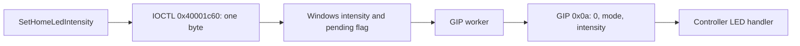

# Windows driver analysis

[Analysis](analysis.md) | [Firmware](firmware.md) | [USB](usb.md) | [Bluetooth](bluetooth-macos.md)

Recorded on 2026-10-24. This is static analysis of four x64 binaries from the
Windows 11 24H2 baseline, with their matching public PDB symbols. Three report
version `10.0.26100.1`; `dc1-controller.sys` reports `1.0.0.1`. These are
pinned analysis inputs, without a claim that they are the latest Windows drivers.
The follow-up audit below adds a newer XInput HID build and the HID-over-GATT
transport. No Windows driver was installed or executed.

## Night mode and the Windows API

Microsoft's [Night mode announcement](https://news.xbox.com/en-us/2021/10/21/october-2021-xbox-update/)
confirms controller dimming on the console. The
[support page](https://support.xbox.com/en-US/help/account-profile/accessibility/how-to-configure-night-mode)
requires JavaScript and supplies no protocol description in its retrieved HTML.
Neither establishes a Bluetooth command or the console's exact implementation.

Windows separately exposes
[`LegacyGipGameControllerProvider.SetHomeLedIntensity(byte)`](https://learn.microsoft.com/en-us/uwp/api/windows.gaming.input.preview.legacygipgamecontrollerprovider.sethomeledintensity?view=winrt-28000),
documented for values 0-100. Its implementation and the receiving driver were
reversed together:

`LegacyGipGameControllerProvider::RuntimeClassInitialize` at `0x180050550`
opens the global `\\.\XboxGIP_Admin` interface. `FromGameControllerProvider`
at `0x18004ba70` requires a GIP provider interface before constructing this
wrapper. This path supplies no conversion from an ordinary Bluetooth HID device
to a GIP device.

| Component and function                                                             | Address       | Observed behaviour                                                                                                                       |
| ---------------------------------------------------------------------------------- | ------------- | ---------------------------------------------------------------------------------------------------------------------------------------- |
| `Windows.Gaming.Input.dll`: `LegacyGipGameControllerProvider::SetHomeLedIntensity` | `0x180050dc0` | Rejects values above 100; calls `DeviceIoControl(handle, 0x40001c60, &intensity, 1, ...)`                                                |
| `xboxgip.sys`: `gipIoControl`                                                      | `0x1c00044e0` | IOCTL `0x40001c60` requires exactly one input byte in 0-100; updates host intensity at `0x1c0054c65` and a pending flag at `0x1c0054c66` |
| `xboxgip.sys`: `gipMessageThread`                                                  | `0x1c0024d10` | Consumes the pending flag and applies the intensity to the first eight GIP device slots                                                  |
| `xboxgip.sys`: `gipSetNexusLEDPatternWithIntensityDevice`                          | `0x1c0029c68` | Constructs GIP command `0x0a`, flags `0x20`, three-byte payload `{0, mode, intensity}`, then sends the fragment                          |
| `xboxgip.sys`: `GipDriverEntry`                                                    | `0x1c01fb078` | Initialises the host intensity to 20                                                                                                     |



This Windows route reapplies a host policy through the LED command already
recovered in the controller firmware. Its inspected branch supplies no EEPROM
write or separate Night mode opcode. The console UI and its binaries were not
analysed, so this does not establish which API the console calls.

## Bluetooth HID comparison

The XInput LED state exposed by `xinputhid.sys` is a separate operation from the
GIP home-button intensity API:

| Function                  | Address       | Observed behaviour                                                                                                                   |
| ------------------------- | ------------- | ------------------------------------------------------------------------------------------------------------------------------------ |
| `DispatchXINPUTIoctl`     | `0x1c0007e88` | Dispatches `0x8000a010` to `DispatchSetGamepadState`, and `0x8000e008` to `DispatchGetLedState`; supplies no branch for `0x40001c60` |
| `DispatchSetGamepadState` | `0x1c000781c` | Input flag bit 0 copies the LED-state byte into device-context offset 0; that branch performs no HID output                          |
| `DispatchGetLedState`     | `0x1c0006fbc` | Returns protocol version `0x0103` and the cached LED-state byte                                                                      |
| `_SendVibrationMessage`   | `0x1c00039a0` | Input flag bit 1 takes this separate rumble path, using HID Physical Interface Device usages                                         |
| `OnIoDeviceControl`       | `0x1c0011110` | Handles selected XInput/HID requests and forwards other requests to the lower stack                                                  |

A successful XInput LED-state set/get round trip therefore does not establish
a physical LED change. The inspected Bluetooth HID path supplies no home-button
brightness report. Lower-stack forwarding remains outside that conclusion.

`Windows.Gaming.Input.dll!HidDevice::SendOutputReport` at `0x180042110`
prepends the HID report ID and calls `PnpDevice::Write`. It supplies ordinary
HID framing, without translating the GIP intensity command into a BLE report.

## Synthetic GIP transport

`xboxgip.sys!gipCreateSyntheticBinding` at `0x1c000d760` creates binding type 2.
`gipAllocateSyntheticSendFragment` at `0x1c000a700` dequeues a Windows read IRP.
For type 2, `gipSendFragment` at `0x1c000b0c4` completes that IRP with
`IofCompleteRequest`. The inspected synthetic route ends in a Windows queue;
it supplies no radio transmission or Bluetooth packet format. A separate
consumer would have to implement a physical transport. That consumer has not
been identified: a queue completion alone does not exclude a downstream
Bluetooth bridge.

## USB and Xbox Wireless test commands

`xboxgip.sys!gipIoControl` also handles IOCTL `0x40001cb8`. It requires input and
output buffers of at least `0x51` bytes, resolves a device ID, and forwards USB
devices through `gipForwardUsbTestCommand` at `0x1c0034190`. That helper builds
another device-control request and sends it to the resolved device stack.

The receiving USB driver is `dc1-controller.sys`, rather than the initially
searched filename `xboxgipusb.sys`. Its `DccEvtIoDeviceControl` at `0x1c0006a20`
handles the forwarded IOCTL. The buffer supplies these fields:

| Buffer offset | Meaning                                           |
| ------------- | ------------------------------------------------- |
| `+0x08`       | Zero requests reply polling after the OUT request |
| `+0x0a`       | USB `bRequest`                                    |
| `+0x0b`       | Little-endian `wValue`                            |
| `+0x0d`       | Little-endian `wIndex`                            |
| `+0x0f`       | Little-endian data length                         |
| `+0x11`       | Request data                                      |

`DccUsbFwSendCommand` at `0x1c0008b0c` builds a vendor-device OUT request
(`bmRequestType=0x40`) from those fields. Reply polling through
`DccUsbFwWaitForCompletion_App` at `0x1c00090d4` uses vendor IN
`c0 00`, `wValue=0x0008`, `wIndex=0xff00`; its first returned byte is status.
These are USB setup fields, without an ATT representation.

For Xbox Wireless, `gipForwardGipTestCommand` at `0x1c00340d0` constructs
`{2, LE16(wValue), LE16(wIndex), LE16(length), data...}`.
`gipUpdateSendUsbMessage` at `0x1c00202d8` sends it as GIP opcode `0x1f`,
flags zero. In the analysed controller application, GIP handler `0x1004aab0`
removes the leading 2 and queues task 3 command `0x20e`. The
[firmware test dispatcher](firmware.md#factory-command-ingress-and-permissions)
maps the remaining fields to internal tasks and checks length and permissions.
This recovers the configuration ingress for USB and GIP; no equivalent BLE
ingress was recovered.

### EEPROM read and write protocols

`DccUsbFwReadEEProm` at `0x1c000835c` first sends vendor OUT request `0x10`,
`wValue=0x030e`, `wIndex=0x0308`, payload `{recordId, 0}`. It takes a two-byte
address from reply offset 4. It then sends the same request with
`wIndex=0x0300` and payload `{addressLE16, length}`. Its requested length is
capped at 60. Firmware selector 3 maps to NV task 13, and commands `0x308`
and `0x300` pass the level-1 whitelist.

This identifies the read protocol for the
[record-0 cap](firmware.md#indirect-brightness-controls). The driver's reply
buffer has a four-byte header; the second polling call requests the data length
directly, while the copy starts at offset 4. This copy alone does not establish
a complete read/restore operation. No test IOCTL, unlock request,
EEPROM read or write was sent during the static-analysis phase. The
[guided campaign](brightness-campaign.md) subsequently tests the runtime and
read-only requests on hardware. It confirmed the USB unlock and steady-LED
commands, and read two identical record-0 slots with valid framing and checksum.
Installed firmware returns `60 00` for the record lookup: the address at offset
4 matches this driver's copy. The newer firmware's three-byte lookup response
also includes capacity. The campaign parser accepts both exact layouts, polls
for the full reply, and validates the record before saving a snapshot.

`DccUsbFwWriteEEProm` at `0x1c0009310` accepts 2-64 bytes and requires the
second byte plus 2 to equal the supplied length. It sends vendor OUT request
`0x10`, `wValue=0x030e`, `wIndex=0x0306`, with `{recordId, length, data...}`,
then polls for completion. Firmware NV dispatcher `0x1006c90e` maps `0x306`
to the record writer, which generates the checksum. This command is absent
from the analysed firmware's level-1 whitelist.

The explicitly authorised physical test first sent record 0 unchanged, with a
private original snapshot and full-slot comparison. The OUT transfer completed,
but no matching `0x0306` reply arrived. Two subsequent reads matched the original
exactly. The runner stopped before changing cap 80 to 5; no restoration write
was needed. See the [campaign result](brightness-campaign.md#recorded-physical-results-2026-10-24)
for the run log and exact sequence. Transfer completion establishes delivery
of the USB request, without proving that the NV writer executed.

`DccUsbFwReadFlash_App` at `0x1c0008510` supplies read command `0x1601`,
`wValue=0x160c`, with `{addressLE32, length:u8}` and chunks of at most 48 bytes.
The campaign tried 16 bytes at application base `0x10027000` after the normal
unlock. Polling returned the old `0x0211` reply until timeout. No installed
application image was obtained. Command `0x1601` is also absent from the newer
firmware's level-1 whitelist. Neither timeout proves that the older installed
firmware implements the same gate.

## UFU firmware update checks

The modern update path is `Windows.Gaming.Input.dll!FwUpdateProcessDevices`
at `0x18006c890`, through `FwUpdateSendCmd` at `0x18006f9bc` and
`xboxgip.sys!gipProcessFwUpdateIoctl` at `0x1c0031ef0`. The legacy
`dc1-controller.sys!DccUsbFw*` vendor-control path above is a separate protocol.
These results use the pinned `10.0.26100.1` library and GIP driver listed below.

`FwUpdateSendCmd` builds a host request for IOCTL `0x40001c70`. Host command 2
wraps a UFU command; the driver validates the device ID, request sizes and update
state, then sends GIP command `0x0c`, flags `0x20`, for modern devices. The
driver selects `0xa1` for legacy `045e:02d1` and `045e:02d2`. Host command numbers
also cover polling and session control; they are not UFU command bytes.

| Check              | Observed behaviour                                                                                                     | Port requirement                                                                                               |
| ------------------ | ---------------------------------------------------------------------------------------------------------------------- | -------------------------------------------------------------------------------------------------------------- |
| Manifest structure | `FwManifestInit`, `0x18006f3b8`, checks magic `0x6d686472`, format 1, at most ten entries, total size and image bounds | Validate the complete package before starting an update, including checked arithmetic and every entry's bounds |
| Device match       | `FwUpdateProcessDevices` compares manifest VID/PID with the UFU device-info reply                                      | Match the selected controller and manifest before writing                                                      |
| Transfer size      | Device-info handling caps the advertised maximum write size at `0x1000` and rounds down to a multiple of four          | Derive block sizes from validated device capabilities                                                          |
| Replies            | The state machine compares the reply command with the pending command and branches on status                           | Reject malformed replies; ignore unrelated replies without advancing the update                                |
| Block contents     | The host calculates SHA-1 over package blocks and compares the device's block hashes                                   | Keep block verification separate from package provenance                                                       |
| Completion         | Success requires the latched verified count to equal the manifest entry count                                          | Preserve per-component progress across passes and expected reconnects                                          |

`FwManifestInit` prints package and component minimum versions but does not
enforce them in that function. The inspected manifest parser and UFU state
machine contain no package-signature verification. This finding is limited to
those functions; package acquisition, Xbox Accessories and controller-side
authentication remain outside this audit.

### Component ordering and completion

`FwUpdateManifestReorderComponents` at `0x18006f7f4` chooses `4, 7, 3, 2, 1`
when component 3 is absent, or when component 2 is present and the new component
3 image is smaller than its reported installed size. Otherwise it chooses
`2, 1, 4, 7, 3`. Missing manifest entries are removed from the order. The caller
uses device replies and manifest history to establish the installed state;
manifest order alone does not determine the write sequence.

The optional `GetVersion` partition tail is not mandatory for an update.
`FwUpdateProcessDevices` accepts its magic or calls
`FwUpdateManifestPopulateSizeFromManifestHistory` at `0x18006f730`. That helper
selects history by VID/PID and installed major/minor version, then supplies a
component size for ordering. It does not supply a partition address. Supplied
metadata must be checked separately. An older component's historical size is
an ordering input; it does not define the write limit for a new package.

The state machine records completion in per-component flags:

- A matching version sets mask `0x02` and increments the verified count, unless
  update flags require processing the component.
- A complete block pass with zero writes sets masks `0x01` and `0x02`; the
  verified count increases only if `0x02` was previously clear. A pass that
  writes blocks marks progress with `0x01` and requires a later verification.
- `BeginUpdate` status 4, "in use", sets `0x04` and moves to the next component.
  It does not increment the verified count.
- Entries whose manifest flags contain `0x01` follow a separate "critical
  component" skip policy that also increments the verified count. The analysed
  MERL `5.23.6.0` package has zero flags on all three entries.

Verified entries are skipped on later passes. Consequently, success represents
the state machine's accumulated completion decisions. It does not require every
component's bytes to match simultaneously at the end. The
[MERL package](firmware.md#download-and-package-identity) places components 3 and 4 at the same
address, `0x10027000`; their exact activation and replacement sequence still
remains unverified; a matching Windows update trace could clarify it. Status 4 alone cannot justify dropping
component 4 from the package or reporting success.

### Operating system checks and validation limits

Windows resolves a PnP interface in `do_UpdateFirmware<PnpDevice>` at
`0x1800296c8`; the GIP driver resolves the host device ID for each update request.
Native update tools need corresponding transport checks on each target OS:

- macOS: obtain exclusive USB access, verify privileges where detachment needs
  them, reclaim the intended controller after re-enumeration, and inhibit sleep.
- Linux: verify device permissions or udev rules, detach and restore `xpad` when
  it owns the interface, reclaim the controller after re-enumeration, and inhibit
  sleep.

These requirements are separate from behaviours established by the Windows
disassembly. No Windows USB update trace was obtained. A later macOS USB update
using xboxctl completed; its [component readback](firmware-update.md#recorded-update-result)
confirms the target versions. Linux update behaviour was not tested.

### Repeat the UFU export

After importing the baseline binaries with the launcher below, export the
existing Ghidra project read-only:

```sh
mise exec java@corretto-25 -- java -Xmx2G -Xshare:off \
  -Djava.awt.headless=true --enable-native-access=ALL-UNNAMED \
  -Djava.system.class.loader=ghidra.GhidraClassLoader \
  -Dapplication.settingsdir="$PWD/target/windows-analysis/settings" \
  -Dapplication.cachedir="$PWD/target/windows-analysis/cache" \
  -cp "$PWD/target/ghidra-native/install/Ghidra/Framework/Utility/lib/Utility.jar" \
  ghidra.Ghidra ghidra.app.util.headless.AnalyzeHeadless \
  "$PWD/target/windows-analysis/projects" XboxWindows \
  -process windows.gaming.input.dll -readOnly -noanalysis \
  -scriptPath "$PWD/tools/ghidra" \
  -postScript XboxWindows.java export "$PWD/target/windows-analysis/ufu-audit" \
  'do_UpdateFirmware|FwUpdate(ProcessDevices|Manifest|SendCmd)'
```

Repeat that command with these substitutions for the other two exports:

| Export | `-process`                 | Output directory suffix | Final function pattern                                                |
| ------ | -------------------------- | ----------------------- | --------------------------------------------------------------------- |
| Driver | `xboxgip.sys`              | `ufu-audit`             | `gip(FwUpdate\|HandleFwUpdate\|ProcessFwUpdate\|CheckFirmwareUpdate)` |
| Parser | `windows.gaming.input.dll` | `ufu-manifest`          | `^FwManifestInit$`                                                    |

The `.controls.c` files contain decompiled functions and instruction listings;
the corresponding `.functions.tsv` files index symbols. Existing run logs are
`target/windows-analysis/ufu-audit-wgi.log`, `ufu-audit-gip.log` and
`ufu-manifest.log`. Downloaded Microsoft binaries, symbols and generated exports
remain local ignored artifacts; this document records addresses and findings.

## XIAO decision

None of the three new runtime leads supplies a distinct BLE packet:

| Lead                               | Recovered endpoint                               | XIAO result                                                 |
| ---------------------------------- | ------------------------------------------------ | ----------------------------------------------------------- |
| Windows intensity API              | Known GIP `0x0a` through `XboxGIP_Admin`         | Existing direct BLE tests already left brightness unchanged |
| Synthetic GIP binding              | Windows IRP queue                                | External consumer remains unresolved                        |
| Factory task commands              | Vendor USB setup or GIP `0x1f`, permission gated | No BLE ingress to the dispatcher                            |

The [guided campaign](brightness-campaign.md) tests raw and GIP-wrapped runtime
frames as explicit BLE hypotheses on the older installed firmware, then tests
the recovered USB route. These hypotheses remain separate from the recovered
firmware dispatch evidence and require a visible, reproduced effect.
Native macOS Bluetooth work remains conditional on a repeatable XIAO success.

## Follow-up audit: newer XInput and the lower BLE driver

The initial four-file audit did not cover the full Windows stack. On 2026-10-24,
two additional AMD64 inputs were downloaded from Microsoft's symbol server with
their matching public PDBs. PE SHA-256 values match Winbindex metadata. The
versions are pinned audit inputs, without a claim about the user's Windows
installation or every release channel:

| Binary and version                                                | Microsoft downloads                                                                                                                                                                                                                                                                                                                       | SHA-256                                                            |
| ----------------------------------------------------------------- | ----------------------------------------------------------------------------------------------------------------------------------------------------------------------------------------------------------------------------------------------------------------------------------------------------------------------------------------- | ------------------------------------------------------------------ |
| `xinputhid.sys`, `10.0.28000.3086`                                | [PE](https://msdl.microsoft.com/download/symbols/xinputhid.sys/C0AF83C920000/xinputhid.sys), [PDB](https://msdl.microsoft.com/download/symbols/XINPUTHID.pdb/5391562EE8823857AB0FD239AD62E1461/XINPUTHID.pdb)                                                                                                                             | `1a6ddddccd54632ad867bf69a3b2438191ca027eb64c38003321af943bbdbd05` |
| `microsoft.bluetooth.profiles.hidovergatt.dll`, `10.0.26100.9278` | [PE](https://msdl.microsoft.com/download/symbols/microsoft.bluetooth.profiles.hidovergatt.dll/D68C8CF439000/microsoft.bluetooth.profiles.hidovergatt.dll), [PDB](https://msdl.microsoft.com/download/symbols/Microsoft.Bluetooth.Profiles.HidOverGatt.pdb/BE2FD718B8949B6DE9022A4741666D851/Microsoft.Bluetooth.Profiles.HidOverGatt.pdb) | `372c3628e3366c18152199eb8fb554d27bb4f02d1356b1f514f711328df4a8d6` |

Microsoft's [HID transport overview](https://learn.microsoft.com/en-us/windows-hardware/drivers/hid/hid-transports)
lists the Bluetooth LE transport as HidBthLE. The additional DLL's matching
symbols identify its current HOGP implementation. This closes an omitted layer
in the initial audit; it supplies no proof that every companion component has
been covered.

| Function                                       | Address       | Follow-up result                                                                                                      |
| ---------------------------------------------- | ------------- | --------------------------------------------------------------------------------------------------------------------- |
| New XInput `DispatchSetGamepadState`           | `0x14000e2ac` | LED flag still copies the byte into context offset 0; hardware output is vibration                                    |
| New XInput `DispatchSetGamepadStateEx`         | `0x14000e58c` | Adds process/focus handling; LED branch still caches the byte, while vibration uses normal or throttled output        |
| HOGP `HidOverGattIoDeviceControl`              | `0x18001f0c8` | Standard HID writes and set-output/set-feature requests call `HidSetReport`; no GIP administrative IOCTL branch found |
| HOGP `GetInputBufferAndReportID`               | `0x18001e408` | Resolves the HID report ID and whether its leading byte must be omitted from the attribute data                       |
| HOGP `HidSetReport`                            | `0x18001faa8` | Copies the report payload into a vector and calls `WriteReportCharacteristicValueAsync`                               |
| HOGP `ValidateAndAddReportCharacteristicToMap` | `0x18001a484` | Reads descriptor `0x2908` to construct the report-ID/type mapping                                                     |
| HOGP `WriteReportCharacteristicValueAsync`     | `0x18001af4c` | Finds the mapped GATT characteristic and writes the supplied bytes; no LED intensity conversion found in this path    |

The new XInput driver's `CheckContext`, completion handler and output-throttle
routine were also exported and inspected. The inspected paths provide no
connection from the cached LED-state byte to a brightness write. The controller's
captured Report References expose input 1 and output 3; the latter is rumble.
A generic HID feature-write method does not establish a feature report on this
controller.

### Synthetic transport coverage and remaining gaps

In the original `xboxgip.sys!gipIoControl`, IOCTL `0x40001c14` queues synthetic
reads, `0x40001c18` validates and injects supplied GIP packets, and
`0x40001c1c` exchanges subscriber/synthetic-device state. A component consuming
the read queue could translate those messages into another transport. Its
identity and traffic remain unresolved.

The original Windows Gaming Input library's `ProviderManager::CreateSyntheticProvider`
at `0x180058f50` creates an `IGameControllerProvider` / `ISyntheticGameControllerProvider`
object. `GipDevice::SendMessageW` at `0x18002fd1c` builds the host GIP envelope,
and `PnpDevice::Write` at `0x180055e04` calls `WriteFile` on the opened interface.
Those inspected functions supply no Bluetooth translation.

The new `XboxWindows.java routes` export lists direct instruction constants for
`0x40001c14`, `0x40001c18`, `0x40001c1c`, `0x40001c60` and `0x40001cb8`, plus
imports. It finds `0x40001c60` in the known Windows LED API. No direct synthetic
queue constants were found in the inspected Windows Gaming Input library,
newer XInput HID or HOGP transport. This is a limited search: computed IOCTL
values can escape it, including branches in `xboxgip.sys` that are known from
decompilation. It cannot establish that no external consumer exists.

Remaining coverage gaps include Xbox Accessories, GameInput services and other
provider components, additional driver versions, and a runtime Windows Bluetooth
trace. No successful Windows BLE dimming operation has been captured. These gaps
prevent a claim that Bluetooth dimming is impossible. A USB-configured startup
cap is a separate candidate. Its unchanged-record write baseline received no
matching completion and left the original intact; cap 5 and restoration remain
untested.

### Repeat this audit

Save the four additional files in `target/research/windows-drivers/audit/`.
Use the Java/Ghidra launcher below with project name `XboxWindowsAudit`, replace
the original four imports with the two additional PE files, and pass this export
pattern after the output directory:

```text
Led|LED|DispatchSetGamepadState|DispatchGetLedState|HogpIo::HidSetReport$|HogpGattAdapter::WriteReportCharacteristicValueAsync$
```

For existing audit projects, use `-process "*" -readOnly -noanalysis` and omit
the preparation script. An additional post-script exports direct IOCTL references:

```sh
-postScript XboxWindows.java routes "$PWD/target/windows-analysis/bridge-audit"
```

Artifacts are under `target/windows-analysis/bridge-audit/`, with focused
subdirectories `hogp-detail/`, `hogp-buffer/` and `xinput-detail/`. The original
provider export is `windows.gaming.input.dll.controls.c` there. Import diagnostics
are in `bridge-import.log`; the existing four-binary project remains separate.

## Input identity and reproduction

[Winbindex](https://github.com/m417z/winbindex) supplied metadata for locating
the files. All four PE binaries and their PDB files were downloaded directly
from Microsoft's public symbol server. The PE SHA-256 values match the indexed
values exactly. PDB URLs use each PE's CodeView GUID and age; Ghidra's PDB
Universal analyser loaded their symbols. Authenticode signatures were not checked.

| Binary                     | Microsoft download                                                                                                                                                                                                                                        | SHA-256                                                            |
| -------------------------- | --------------------------------------------------------------------------------------------------------------------------------------------------------------------------------------------------------------------------------------------------------- | ------------------------------------------------------------------ |
| `xinputhid.sys`            | [PE](https://msdl.microsoft.com/download/symbols/xinputhid.sys/4A6B4DBE16000/xinputhid.sys), [PDB](https://msdl.microsoft.com/download/symbols/XINPUTHID.pdb/95D3C87A5D9E5081068C8AD0AE96F0F21/XINPUTHID.pdb)                                             | `6019b99f233fac875cde032ca59e122164b4db4ac3ba7729aefd98f894b6da2d` |
| `xboxgip.sys`              | [PE](https://msdl.microsoft.com/download/symbols/xboxgip.sys/723D661D200000/xboxgip.sys), [PDB](https://msdl.microsoft.com/download/symbols/XBOXGIP.pdb/C1FA44D09577D1777211D1185F9ECB1B1/XBOXGIP.pdb)                                                    | `b250a443eb815932847da8407fdd961579da4916c1cd465355e99b10532b10e1` |
| `windows.gaming.input.dll` | [PE](https://msdl.microsoft.com/download/symbols/windows.gaming.input.dll/4F1FB72Cd2000/windows.gaming.input.dll), [PDB](https://msdl.microsoft.com/download/symbols/Windows.Gaming.Input.pdb/3C83220AAF7F00776BBCA2B50FF61A441/Windows.Gaming.Input.pdb) | `3248762379a480a8aeba1266ae097b5b5413975f8f422d5fd36f9ec6b748c0be` |
| `dc1-controller.sys`       | [PE](https://msdl.microsoft.com/download/symbols/dc1-controller.sys/3F266A3518000/dc1-controller.sys), [PDB](https://msdl.microsoft.com/download/symbols/dc1-controller.pdb/3F7506E0DF366C416C028BF10386E96F1/dc1-controller.pdb)                         | `3ef65b989d560c936bed9006c9e1975a866d934852972ad35e161fa6349a94dc` |

Save the eight linked files under `target/research/windows-drivers/`, preserving
the filenames from the links. The symbols are `XINPUTHID.pdb`, `XBOXGIP.pdb`,
`Windows.Gaming.Input.pdb` and `dc1-controller.pdb`. Download example:

```sh
mkdir -p target/research/windows-drivers
curl --fail --location \
  https://msdl.microsoft.com/download/symbols/xinputhid.sys/4A6B4DBE16000/xinputhid.sys \
  --output target/research/windows-drivers/xinputhid.sys
curl --fail --location \
  https://msdl.microsoft.com/download/symbols/XINPUTHID.pdb/95D3C87A5D9E5081068C8AD0AE96F0F21/XINPUTHID.pdb \
  --output target/research/windows-drivers/XINPUTHID.pdb
```

[XboxWindows.java](../tools/ghidra/XboxWindows.java) configures the local PDB
path before import and exports selected functions with decompiled C, callers,
callees and instruction listings. It requires the Ghidra installation described
in [Firmware](firmware.md#repeat-the-offline-analysis), including its native
decompiler. Run from the repository root after downloading all eight files:

```sh
mkdir -p target/windows-analysis/projects
mise exec java@corretto-25 -- java -Xmx2G -Xshare:off \
  -Djava.awt.headless=true --enable-native-access=ALL-UNNAMED \
  -Djava.system.class.loader=ghidra.GhidraClassLoader \
  -Dapplication.settingsdir="$PWD/target/windows-analysis/settings" \
  -Dapplication.cachedir="$PWD/target/windows-analysis/cache" \
  -cp "$PWD/target/ghidra-native/install/Ghidra/Framework/Utility/lib/Utility.jar" \
  ghidra.Ghidra ghidra.app.util.headless.AnalyzeHeadless \
  "$PWD/target/windows-analysis/projects" XboxWindows \
  -import "$PWD/target/research/windows-drivers/xinputhid.sys" \
  -import "$PWD/target/research/windows-drivers/xboxgip.sys" \
  -import "$PWD/target/research/windows-drivers/windows.gaming.input.dll" \
  -import "$PWD/target/research/windows-drivers/dc1-controller.sys" \
  -scriptPath "$PWD/tools/ghidra" -max-cpu 4 -analysisTimeoutPerFile 240 \
  -preScript XboxWindows.java prepare "$PWD/target/research/windows-drivers" \
  -postScript XboxWindows.java export "$PWD/target/windows-analysis"
```

Run import once. For later inspection, replace the four `-import` options with
`-process "*" -readOnly -noanalysis` and omit `-preScript`. An optional regex
after the export directory selects other function names.

Outputs are `<binary>.functions.tsv` and `<binary>.controls.c` under
`target/windows-analysis/`. More focused exports remain under `gip-route/`,
`hid-route/`, `config-route/`, `provider-route/`, `synthetic-route/`,
`usb-route/`, `dc1-route/` and `dc1-detail/`. Import diagnostics are in
`import.log` and `dc1-route.log`.
Ghidra reported non-fatal data-demangling errors at `0x1800becca` in the Windows
Gaming Input library. The relevant LED functions decompiled and their
instructions were inspected. No Windows runtime, console trace or optical test
was performed.
